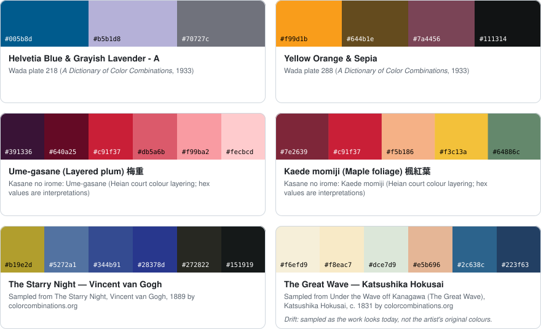
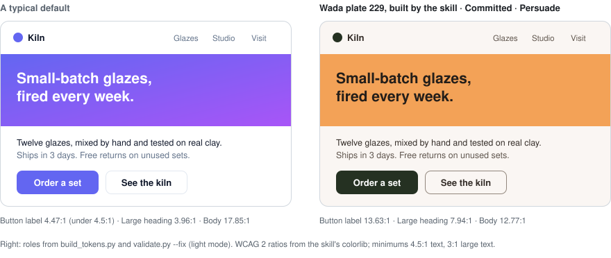

# artistic-color-palettes

**Real artistic colour palettes for coding agents, made into working UI colour systems.** An Agent
Skill for Claude Code, Codex, Cursor, Gemini CLI, GitHub Copilot, OpenCode and other agents that read
`SKILL.md`.

<picture>
  <source media="(prefers-color-scheme: dark)" srcset=".github/assets/palettes-dark.svg">
  
</picture>

It replaces an agent's usual default colours with palettes that have a real source. Those sources
are Sanzo Wada's *A Dictionary of Color Combinations* (plates 1–348), Heian *kasane no irome*
layered colour patterns, palettes sampled from public-domain paintings, and editorial palettes from
colorcombinations.org.

You can ask in everyday colour words ("ocean", "pastel pink", "coffee", "dark and muted") or start
from a brand colour, and it finds palettes that hold a close match. It shows 3–5 candidates as
applied mini-layouts in light, dark and greyscale, and lets you choose one.

It then builds:
- OKLCH ramps and two-tier design tokens
- colour proportions
- measured WCAG 2 and APCA contrast
- a composed (not inverted) dark mode

These follow the perceptual principles of Josef Albers' *Interaction of Color*. The result goes into
`DESIGN.md`, `design/palette.json` and `design/tokens.css`, where neighbouring design skills can
read it.

It never invents a plate, painting or pattern, and every palette carries its provenance. The bundled
scripts are Python 3.10+ standard library only and need no network.

## Install

```bash
npx skills add youssef4laa/artistic-color-palettes --skill artistic-color-palettes
```

The skill is listed on
[skills.sh](https://skills.sh/youssef4laa/artistic-color-palettes/artistic-color-palettes).

This installs the skill into the current project for the agents you pick, using the
[`skills` CLI](https://github.com/vercel-labs/skills). Add `-g` for a user-level install. To update,
run the same command again: it is idempotent and keeps the links in place. On Windows without
symlink support, add `--copy`.

**Claude Code plugin marketplace**

```bash
claude plugin marketplace add youssef4laa/artistic-color-palettes
claude plugin install artistic-color-palettes@artistic-color-palettes
```

Inside a session, the same steps are `/plugin marketplace add youssef4laa/artistic-color-palettes`
and `/plugin install artistic-color-palettes@artistic-color-palettes`. The plugin installs only
`skills/artistic-color-palettes/`.

To install from a local clone, use either command with the clone's path, for example
`npx skills add ./artistic-color-palettes --skill artistic-color-palettes`.

## Works in your agent

Tested on 2026-10-24 on macOS with `skills` CLI 1.7.4 and Claude Code 2.1.300. Fourteen agents were
checked at project and user level:
- every link resolves;
- `SKILL.md` passes the Agent Skills spec;
- the scripts run through each agent's path;
- the full test suite passes through the symlink.

Claude Code was also tested in a live session: it loaded the skill through the symlink, ran the
search and stopped for a choice. The plugin channel was tested on 2026-10-23 on Windows (Claude
Code 2.1.296).

| Agent | Project install (`npx skills add`) | User install (`-g`) |
|---|---|---|
| Claude Code | `.claude/skills/` → symlink to `.agents/skills/` | `~/.claude/skills/` → symlink |
| Cline, Codex, Kimi Code CLI, Pi, Warp, Zed | `.agents/skills/` | `~/.agents/skills/` |
| Amp, Cursor, Droid, Gemini CLI, GitHub Copilot, Kilo Code, OpenCode | `.agents/skills/` | `~/.agents/skills/` (see below) |

The `skills` CLI lists a user folder of its own for the last row's agents, for example
`~/.cursor/skills/`, `~/.gemini/skills/` and `~/.config/opencode/skills/`. With `-g`, though, it
writes only to `~/.agents/skills/`. If your agent doesn't pick the skill up after a user-level
install, link it in yourself. The scripts were tested through relative and absolute links:

```bash
mkdir -p ~/.cursor/skills && ln -s ~/.agents/skills/artistic-color-palettes ~/.cursor/skills/
```

## See it

<picture>
  <source media="(prefers-color-scheme: dark)" srcset=".github/assets/before-after-dark.svg">
  
</picture>

The right-hand side is real output: `build_tokens.py --palette wada-229 --strategy committed --mode
persuade` followed by `validate.py --fix`. With GitHub in dark mode, the image shows the composed
dark theme. The images are regenerated by
[`.github/scripts/readme_assets.py`](.github/scripts/readme_assets.py).

## Try it

Ask your agent:

- "Find me a palette for a coffee roastery landing page."
- "Our brand teal is #2a9d8f. Which real palettes hold something close?"
- "Give this dashboard a restrained Wada palette with a proper dark mode."
- "Use the kasane pattern Kaede momiji for an autumn landing page and write the tokens."
- "Make the colours look less generic."

The skill lives in `skills/artistic-color-palettes/`. Start with its
[`SKILL.md`](skills/artistic-color-palettes/SKILL.md).

## Works with

The skill handles colour only. Typography, layout, motion, components and copy are left to the
skills below.

| Skill | What is shared | How |
|---|---|---|
| [Impeccable](https://github.com/pbakaus/impeccable) | `PRODUCT.md` is read; the palette, strategy and mode (Impeccable's own names) go into two marker regions of `DESIGN.md` | Automatic: Impeccable loads `DESIGN.md` through `impeccable context`. When its document step asks, choose *merge* and re-run the hand-off |
| [Taste](https://github.com/Leonxlnx/taste-skill) | Alias tokens `--bg --surface --ink --muted --accent --accent-ink --field-n` in `tokens.css` | Through the opt-in `CLAUDE.md`/`AGENTS.md` pointer, or by running Taste with `--keep palette` |
| Design Principles ([owl-listener](https://github.com/owl-listener/designer-skills), [libreuiux](https://github.com/ormus-solutions/libreuiux-claude-code)) | Proportion rules written as Named Rules in `DESIGN.md` (in place of 60-30-10) | Through the opt-in pointer; neither reads a palette file |
| [UI/UX Pro Max](https://github.com/nextlevelbuilder/ui-ux-pro-max-skill) | Alias tokens `--color-primary … --color-ring`; with your consent, one pointer line in its `MASTER.md` | Its token names resolve to ours once `tokens.css` is used; keep its pattern and type output and never run it with `--force` |
| [Theme Factory](https://github.com/anthropics/skills) | Its custom-theme colour bullets (background, text, accent, one secondary) built from `palette.json` | Through the opt-in pointer, or by telling it to use the shared palette |

The `CLAUDE.md` / `AGENTS.md` pointer is opt-in: the skill asks once per project and never writes
to your global `~/.claude/CLAUDE.md`.

## Publishing checklist

1. Push the repo to `youssef4laa/artistic-color-palettes` as a public repository (commit and tag `v0.1.1` yourself).
2. Check how skills.sh indexes it: run `npx skills add youssef4laa/artistic-color-palettes --list` and search for the skill on skills.sh.
3. Share the marketplace command: `claude plugin marketplace add youssef4laa/artistic-color-palettes`.
4. Optional: submit the plugin to Anthropic's directory (PR to `anthropics/claude-plugins-official`).
5. Keep `skills/artistic-color-palettes/data/SNAPSHOT.md` dated whenever the data is refreshed, and bump the version in `plugin.json`, `marketplace.json` and the `SKILL.md` frontmatter together.
6. The marketplace entry installs only `skills/artistic-color-palettes/`. Maintainer material (`notes/`: build notes, eval sets and reviews; `data-raw/`: the raw data snapshot that `scripts/build_data.py` reads) lives on the `sources` branch. Its README explains how to rebuild the data from a worktree of that branch.
7. After changing the data or the demo palette, re-run `python3 .github/scripts/readme_assets.py`. Then render `.github/assets/card.html` to `social-preview.png` at 1280×640 and upload it under Settings → Social preview.

## Data sources and licences

- **Code and text:** MIT ([LICENSE](LICENSE)).
- **`references/kasane-no-irome.md`:** CC BY-SA 4.0. Base colour names and hex values come from
  Wikipedia, "Traditional colors of Japan" (CC BY-SA 4.0). Pattern recipes follow Heian court
  records as compiled by Anthony J. Bryant; they are restated in our own structure. The 33 kasane rows in
  `data/palettes.csv` carry the same share-alike licence.
- **Palette data:** colorcombinations.org (Caslon Media), CC BY 4.0. Wada plate digitisation by
  Matt DesLauriers (mattdesl), MIT. Sanzo Wada's plates (1933–34) are public domain, and the
  sampled paintings are public-domain works.
- **README images** (`.github/assets/`): drawn from `data/palettes.csv` with the attributions
  above. The two kasane strips carry CC BY-SA 4.0. No plate scans or book pages are reproduced.
- **Books:** ideas from Wada's *A Dictionary of Color Combinations* (Seigensha reprint) and
  Albers' *Interaction of Color* are paraphrased with page or chapter citations. No plates,
  diagrams or long quotations are reproduced.

Full attributions, snapshot date and checksums:
[`NOTICE.md`](skills/artistic-color-palettes/NOTICE.md) and
[`data/SNAPSHOT.md`](skills/artistic-color-palettes/data/SNAPSHOT.md).

This project is not affiliated with Seigensha, the Wada estate or colorcombinations.org.
